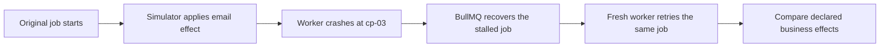

# One invoice job applies an email effect twice

This walkthrough uses Retryglass alpha.2, a synthetic BullMQ invoice job, disposable PostgreSQL and Redis, and an HTTP simulator. The example represents a common retry problem. It uses no live queue, database, or email provider.

The worker creates an invoice, calls the email simulator, and adds a reminder job. The first worker crashes just after the simulator has accepted its request. The retry can finish the invoice and leave one reminder while applying a second email effect. The buggy worker generates a new idempotency key for every request. The corrected worker uses the job's stable business key.

## How Retryglass finds it

Retryglass first runs the synthetic processor to discover completed operations it can interrupt. In this fixture, `cp-03` follows the simulator request. It opens a separate disposable cell for that point, crashes the worker there, verifies the crash and stalled-job recovery, then retries the same persisted job with a fresh worker.



The report keeps before, partial and final database row snapshots alongside the job attempts and simulator ledger. The rule `one-provider-action` expects one applied effect. The buggy control observed two. Two HTTP requests alone would not prove duplication because the simulator can accept a repeated request without applying another effect.

## Reproduce the finding

Use Node 24.22.1 in a new empty directory. Complete the [OrbStack and base-image setup](../README.md#run-a-real-rehearsal-through-orbstack). The first sweep can build the trusted image from the bundled example.

```sh
npm init -y
npm install --save-dev --ignore-scripts https://github.com/CVamsi27/retryglass/releases/download/v0.1.0-alpha.2/retryglass-0.1.0-alpha.2.tgz vitest@5.0.5
npx --no-install retryglass init --target ./my-rehearsal
npx --no-install retryglass validate --scenario ./my-rehearsal/scenario-buggy.json
npx --no-install retryglass sweep --scenario ./my-rehearsal/scenario-buggy.json --crash-point cp-03 --json > buggy-sweep.json
```

The sweep is expected to exit 1 and write a report. In `sweep.crashPoints[0]`, check for `crashVerified: true`, `recovery: stalled`, and the `one-provider-action` violation. The selected point has complete declared evidence. The sweep is partial because it ran only one of the discovered points. Check that cleanup completed.

## Keep the point as a test

```sh
run_id="$(node -p "require('./buggy-sweep.json').runId")"
mkdir -p ./regression
npx --no-install retryglass export --run "$run_id" --crash-point cp-03 --target ./regression/invoice
npx --no-install vitest run ./regression/invoice/retry.test.ts
```

The exported test fails with the buggy processor. In `regression/invoice/scenario.json`, set `worker.processor` to `dist/examples/invoice/corrected.js`. Rerun the same test. It passes when the single business key keeps the simulator at one applied effect.

For your own worker, start with one pure processor and one effect that matters, such as creating an invoice, sending one notification, or enqueueing one follow-up. Use synthetic fixtures, discover the relevant point with a sweep, and keep that selected test in the normal suite. The result covers the tested job, point, and declared surfaces. See the [scenario reference](scenarios.md) and [verification record](verification.md).
